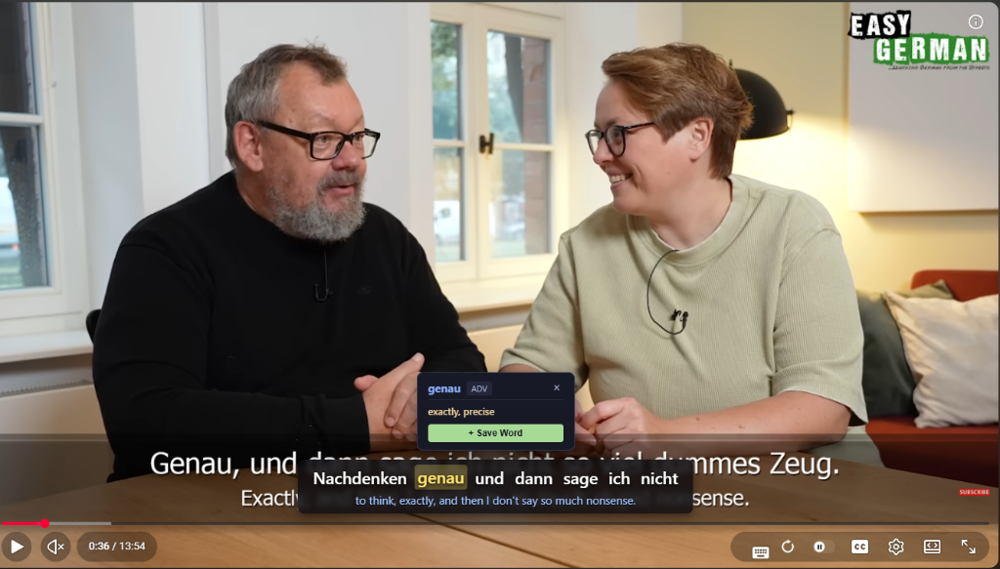
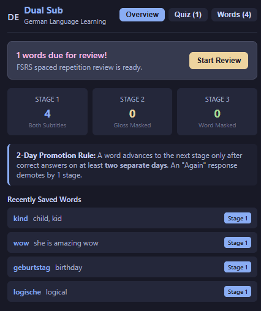
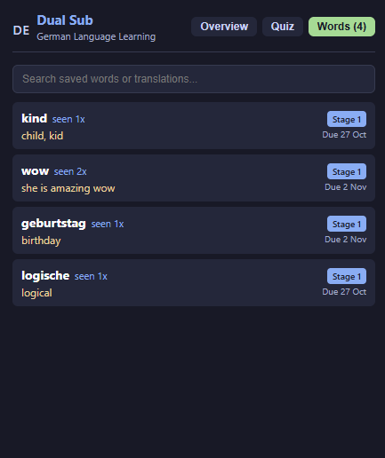
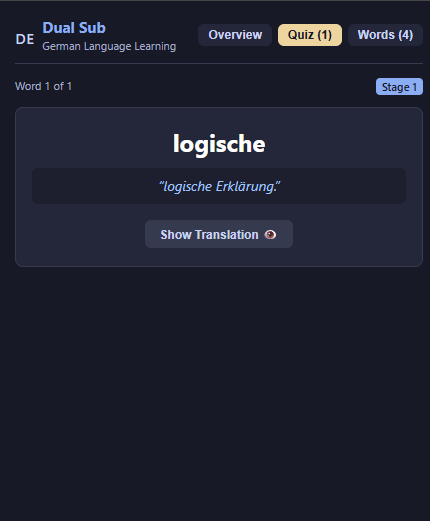
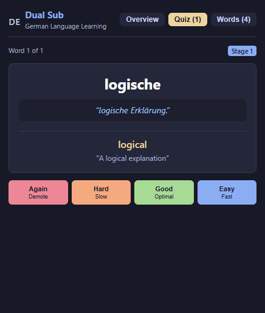

# 🇩🇪 Dual Sub — Language Learning for YouTube

[](https://developer.chrome.com/docs/extensions/mv3/intro/)
[](https://www.typescriptlang.org/)
[](https://preactjs.com/)
[](https://vitejs.dev/)
[](https://github.com/open-spaced-repetition/fsrs4anki)
[](https://vitest.dev/)

An advanced, privacy-first **Manifest V3 Chrome Extension** designed to turn YouTube into an immersive German language acquisition environment. Featuring synchronized bilingual subtitles, instant click-to-lookup dictionary, adaptive 3-stage progressive word masking, and context-aware flashcards powered by the **FSRS-5** spaced repetition algorithm.

---

## 📸 Screenshots & Showcase

### 1. Interactive Dual Subtitles & In-Player Dictionary
Hover over any word to inspect its lemma, part of speech, and English definitions—or click **+ Save Word** to immediately add it to your spaced repetition study deck with the current video sentence saved as context.

<p align="center">
  
</p>

---

### 2. Learning Dashboard & Saved Vocabulary Library
Track your active review queues, monitor vocabulary stage distributions, and review the status of every saved word alongside its scheduled FSRS review dates.

<p align="center">
  
  
</p>

---

### 3. Contextual FSRS Spaced Repetition Quizzes
Review your saved words directly inside the extension popup. Every flashcard pairs the target word with the actual sentence you encountered on YouTube, with memory intervals calculated via Free Spaced Repetition Scheduler (FSRS-5).

<p align="center">
  
  
</p>

---

## ✨ Key Features

- **Adaptive Bilingual Subtitles on YouTube**:
  - Automatically loads and synchronizes German target captions and English translations.
  - Zero-latency overlay rendered inside an isolated **Shadow DOM** to prevent CSS bleeding or interference from YouTube's native styles.
  - Native caption suppression to eliminate overlapping subtitle clutter.

- **Offline Embedded German Dictionary**:
  - Instant word tokenization and morphological lemmatization (handles inflections, compound verbs, and umlauts: *ä, ö, ü, ß*).
  - Fast offline lookup for common German vocabulary with online API failover for rare words.

- **3-Stage Progressive Word Masking**:
  - Systematically reduces reliance on translations as you learn:
    - **Stage 1 (Both Subtitles)**: Full German sentence and full English gloss are visible.
    - **Stage 2 (Gloss Masked)**: The English translation for saved words is masked with `___` (hover/click reveals it), encouraging active recall from context.
    - **Stage 3 (Word Masked)**: The German word itself is masked with `___`, prompting you to predict or recall the spoken word before it plays.
  - **2-Day Promotion Rule**: Prevents cramming by requiring successful reviews on at least two distinct calendar days before advancing a word to the next stage.

- **State-of-the-Art Spaced Repetition (FSRS-5)**:
  - Employs the `ts-fsrs` algorithm (superior retention optimization compared to legacy SM-2).
  - 4 rating choices: **Again** (demotes 1 stage), **Hard** (shorter interval), **Good** (optimal interval), and **Easy** (longer interval).

- **Resilient Multi-Tier Caption Pipeline**:
  - **MAIN World Bridge**: Intercepts YouTube player responses and session-authenticated timedtext endpoints.
  - **Sliding-Window Lookahead Batching**: Translates upcoming subtitle lines in bulk using sentinel pipe delimiters (`\n|||\n`), avoiding rate limits.
  - **Automatic Fallback Translation**: Gracefully falls back to Google Translate API & MyMemory with automated HTML entity sanitization.

- **Clean Local-First Storage**:
  - All saved words, review history, and dictionary caches are stored locally in your browser via **IndexedDB** (`Dexie.js`). No external tracking or account required.

---

## 🛠️ Architecture & Tech Stack

| Component | Technology | Purpose |
| :--- | :--- | :--- |
| **Runtime** | Chrome Extensions MV3 | Manifest V3 compliance with service workers |
| **Build System** | Vite + `@crxjs/vite-plugin` | Ultra-fast HMR and standalone IIFE content bundling |
| **Language** | TypeScript (strict) | End-to-end type safety across content scripts and popup |
| **UI Framework** | Preact | Ultra-lightweight (~3kB) reactive UI for extension popup |
| **Database** | Dexie.js (IndexedDB) | Local persistence for vocabulary, occurrences, and SRS states |
| **Algorithm** | `ts-fsrs` | Spaced repetition memory scheduling based on FSRS-5 |
| **Testing** | Vitest + Happy DOM | Unit tests covering SRS math, alignment, masking, and entities |

---

## 🚀 Getting Started (Developer Setup)

### Prerequisites
- Node.js (v18 or higher recommended)
- `pnpm` (or `npm` / `yarn`)

### Installation & Build

1. **Clone the repository**:
   ```bash
   git clone https://github.com/your-username/dual-sub.git
   cd dual-sub
   ```

2. **Install dependencies**:
   ```bash
   pnpm install
   ```

3. **Build the extension**:
   ```bash
   pnpm run build
   ```
   *The compiled extension will be output to the `dist/` directory.*

4. **Run test suite**:
   ```bash
   pnpm test
   ```

---

## 🧩 Installing into Google Chrome / Chromium

1. Open Google Chrome and navigate to `chrome://extensions`.
2. Enable **Developer mode** using the toggle switch in the top-right corner.
3. Click the **Load unpacked** button in the top-left corner.
4. Select the **`dist`** directory inside the project repository.
5. Open any YouTube video in German (e.g., [Easy German](https://www.youtube.com/@EasyGerman)).
6. Dual subtitles will appear above the player controls!

---

## 🎯 Keyboard Shortcuts & Tips

| Action | Control |
| :--- | :--- |
| **Inspect Word** | Hover mouse cursor over any German word |
| **Pin / Unpin Word Card** | Click on any German word |
| **Close Card Tooltip** | Press `Esc` or click outside |
| **Reveal Masked Word / Gloss** | Click or hover over `___` |
| **Open Study Popup** | Click the Dual Sub extension icon in your browser toolbar |

---

## 📂 Project Structure

```text
LangProj/
├── data/                      # Embedded offline dictionaries (form-to-lemma, lemma-to-gloss)
├── docs/
│   └── screenshots/           # UI showcase images for documentation
├── src/
│   ├── background/            # MV3 background service worker & batch translation router
│   ├── content/               # Content scripts
│   │   ├── bridge.ts          # Isolated world content script (DOM overlay coordinator)
│   │   ├── main-world.ts      # MAIN world script (YouTube player & caption interceptor)
│   │   ├── captions/          # Timedtext extractors, XML/JSON3 parsers, aligners
│   │   └── overlay/           # Shadow DOM container, sync controller, renderer, styles
│   ├── db/                    # Dexie IndexedDB schemas and data access helpers
│   ├── dictionary/            # Local lemmatizer and dictionary lookup engine
│   ├── masking/               # 3-stage progressive word masking logic
│   ├── popup/                 # Preact extension popup (Overview, Quiz, Words tabs)
│   ├── srs/                   # FSRS-5 review calculations & stage promotions
│   └── utils/                 # Time formatting and HTML entity decoding
├── manifest.json              # Chrome Extension MV3 manifest definition
├── vite.config.ts             # Vite configuration with standalone IIFE script setup
└── vitest.config.ts           # Vitest configuration for unit test runs
```

---

## 🧪 Testing

The codebase includes an extensive suite of automated unit tests covering:
- Caption timestamp alignment and XML/JSON3 parsing.
- Morphological lemmatization and gloss extraction.
- FSRS-5 spaced repetition interval calculations and ratings.
- 3-stage masking and token replacement rules.
- HTML entity decoding (`&#39;`, `&quot;`, `&amp;`).

To execute tests:
```bash
pnpm test
```

---

## 📄 License

This project is open-source and available under the [MIT License](LICENSE).
